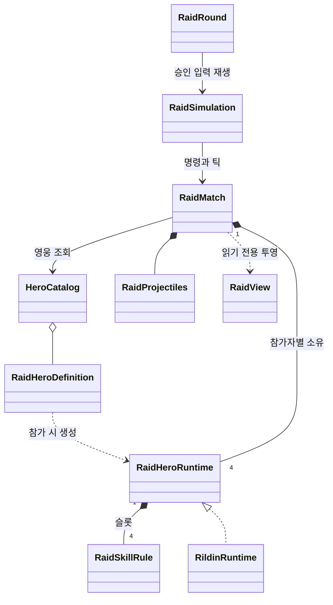

# 런앤레이드 영웅과 스킬의 구조 설계

Babylon.js 플레이판의 기준 구현은 `58a562b`다. 아래 디렉터리와 공개 계약은 다음 리팩터링의 목표다. **영웅은 네 슬롯의 구성과 고유 행동을 소유하고, 경기는 시간·이동·피해·승패를 확정한다.** 영웅 하나의 연계나 사거리를 바꿀 때 검토해야 할 파일을 해당 영웅과 사용하는 공통 판정으로 한정한다.

## 현재 결합이 만드는 문제

- 릴딘 Q의 `previewSkill`은 영웅 공통 반경 3.5m의 원을 검사한다. `cast`는 전방 5m, 강화 중 6.5m와 높이 조건을 검사한다. 전방 4.5m에 지상 적 한 명을 두면 미리보기 집계는 0명이고 실제 피해는 9다. 즉발 버튼에는 이 집계가 노출되지 않지만 두 경로가 서로 다른 기술을 설명한다. [현행 판정](../babylon/src/game/raid/raid-match.ts)
- 모든 주자가 릴딘의 연속 베기, 카이켄의 월광, 스위프트의 표식 상태를 함께 갖는다. HUD는 만월의 재입력 가능 여부를, 씬은 표식·반격·검 강화를 이 내부 상태에서 직접 읽는다. 상태 필드 하나를 옮기는 작업이 전투와 표시 양쪽에 걸린다. [검사 상태](../babylon/src/game/raid/raid-blades.ts) · [HUD](../babylon/src/ui/raid-hud.ts) · [주자 표시](../babylon/src/platform/babylon/raid/raid-actor.ts)
- 스킬 입력 유형은 영웅·슬롯 분기로 정한다. 투사체의 사거리는 프로필에 있고 낮은 검기의 충돌 폭과 통과 높이는 비행 루프에 있다. 봇도 별도로 사거리와 스킬 유형을 선택한다. 반면 접촉 시점 계산과 틱별 입력 재생은 이미 독립적으로 검증할 수 있다. [투사체](../babylon/src/game/raid/raid-projectiles.ts) · [봇](../babylon/src/game/raid/raid-bots.ts) · [경기 재생](../babylon/src/game/raid/raid-round.ts)

## 목표 디렉터리

경로는 `babylon/src/` 기준이다. 영웅 ID는 기존의 `hammer, abyss, longshot, jade, rend, bastion, rime, rildin, kaiken, swift`를 사용한다.

```text
app/
  run-and-raid.ts                  솔로·방장·참가자 진입, 입력 및 화면 연결
  raid/create-raid-rules.ts        영웅 수치와 행동의 명시적 조립, 카탈로그 주입
content/
  raid/heroes/<hero-id>.ts         해당 영웅의 기본 능력치와 네 슬롯의 튜닝값
  locales/{run-and-raid.ts,ko/run-and-raid.ts}
game/raid/
  raid-match.ts                    한 경기의 시계, 참가자, 효과 수명과 처리 순서
  raid-feature.ts                  기존 raid.* 명령의 세션 바인딩과 입력 해석
  raid-simulation.ts               세션 명령 → 봇 → 전투 한 틱
  raid-round.ts                    승인 입력의 순서와 재생
  raid-draft.ts, raid-bots.ts      선택 가능한 영웅 조회, 봇의 이동·기술 선택
  raid-view.ts                     주자·슬롯·액션의 읽기 전용 표시 계약
  heroes/
    hero-definition.ts             RaidHeroDefinition, RaidHeroRuntime, 슬롯 튜플
    hero-catalog.ts                안정 ID, 선택 순서, 조회 계약
    <hero-id>.ts                   해당 영웅의 행동 조합, 고유 상태와 패시브
  skills/
    skill-rule.ts                  입력 종류별 계약, 판정 결과, 시전 비용
    targeting.ts                   전방 부채꼴·원·지점·대상·방향 판정 함수
    skill-effects.ts               반복되는 즉시 타격·회복·효과 시작 조합
  combat/
    hit-resolution.ts              틱의 피해 대기열, 반격, 기여도·처치 처리
    runner-motion.ts               달리기·도약·돌진 위치 계산과 보간 입력
    active-effects.ts              도로에 남는 장판과 시전자를 따라가는 주기 효과
  raid-boss.ts, raid-sight.ts      마차 반격, 카메라 시야와 전방 각도
  raid-projectiles.ts              발사체 비행, 이동 표적 충돌, 관통과 중복 타격 처리
  raid-control.ts                  감속·침묵·경직 적용 규칙
platform/babylon/raid/             모델·모션·FX와 화면 좌표를 게임 입력으로 변환
ui/raid-{hud,aim-pad,lobby}.ts      버튼·패드·로비 표시와 사용자 의도 전달
```

예를 들어 `content/raid/heroes/rildin.ts`에서 Q의 거리와 콤보 시간을 조정하고, `game/raid/heroes/rildin.ts`에서 네 번째 Q 뒤에 기본 공격 대기를 초기화할지 결정한다. 수치 파일은 직렬화 가능한 데이터다. 행동 모듈이 요구하는 수치 타입에 `satisfies`를 적용해 누락과 오기를 잡는다. `app/raid/create-raid-rules.ts`는 두 파일을 묶어 영웅 정의를 등록한다. 전투 코드는 `app`, 로캘 또는 엔진을 import하지 않는다.

카탈로그는 기존 `HERO_IDS` 순서의 목록과 ID 조회를 제공한다. 이 순서는 솔로 동료와 온라인 빈자리의 영웅 선택에도 쓰인다. 각 ID에 같은 ID의 정의가 정확히 하나씩 있도록 매핑 타입으로 검사한다. 로비·드래프트·테스트·초상화 도구도 이 목록을 사용한다. 실제 전투 세션을 만들기 전에는 영웅의 가변 상태를 만들 필요가 없다. [현재 빈자리 배정](../babylon/src/game/raid/raid-round.ts) · [초상화 제작 도구](../babylon/tools/raid-portraits.html)

조립 지점은 `createRaidRules()` 한 곳이다. 여기서 만든 카탈로그를 `RaidMatch`와 `RaidRound`의 생성자에 전달하고, 라운드가 내부 경기를 만들 때도 같은 카탈로그를 넘긴다. 솔로는 기존 기기 화면비 함수를, 온라인은 기존 고정 화면비를 경기 생성 시 전달한다. 화면 없는 테스트도 같은 조립 함수를 import할 수 있도록 이 파일은 DOM·Photon·Babylon 모듈을 참조하지 않는다.

## 클래스와 공개 계약



| 계약 또는 클래스 | 생성 단위 | 소유권과 호출 시점 |
| --- | --- | --- |
| `RaidHeroDefinition` | 영웅 ID당 하나 | 불변 능력치 및 슬롯 설명을 제공한다. `createRuntime()`은 참가자 한 명의 행동 구현을 생성한다. 로비는 정의만 조회한다. |
| `RaidHeroRuntime` | 경기의 참가자당 하나 | 네 슬롯의 행동과 고유 상태를 소유한다. 예를 들어 `RildinRuntime`은 연계·반격 만료 틱을 가진다. 고유 상태가 없는 영웅은 공통 팩토리에서 네 행동을 조합한다. 상속 계층은 필요하지 않다. |
| `RaidSkillRule` | 런타임의 슬롯당 하나 | 현재 상태에 맞는 입력 방식과 판정 함수를 반환한다. 같은 함수가 현재 사거리·공격 모양·사용 가능 여부 및 성공 시 실행할 동작을 결정한다. |
| `RaidMatch`, `RaidProjectiles` | 경기당 하나씩 | 경기는 주자의 공통 상태, 피해 대기열과 진행 중 효과를 소유한다. 투사체는 발사 당시 프로필·방향과 한 발사에서 이미 맞은 대상을 소유한다. 영웅이 다른 주자의 체력이나 경기 시계를 직접 수정할 수 없다. |
| `RaidView`, `SkillView` | 현재 틱에서 읽는 값 | HUD·씬·봇에 체력, 시전 가능 상태, 입력 모드, 콤보 횟수, 남은 시간, 표식 대상 등을 필요한 범위로 노출한다. 렌더 보간은 읽기 전용이다. |

다음은 모듈 사이의 TypeScript 계약 발췌다. `SkillRead`는 현재 틱·시전자·위치·대상 조회만, `CombatWriter`는 타격 예약·회복·이동 및 효과 시작처럼 권위 경기가 제공하는 연산만 노출한다.

```ts
type Slots<T> = readonly [T, T, T, T]
type CastIntent =
  | { kind: 'instant' }
  | { kind: 'direction'; dx: number; dz: number }
  | { kind: 'ground'; x: number; z: number }
  | { kind: 'enemy'; target: RaidTarget }
  | { kind: 'ally'; ally: number }

interface RaidHeroDefinition<H extends RaidHero = RaidHero> {
  readonly id: H
  readonly stats: HeroStats
  readonly slots: Slots<SkillDescription>
  createRuntime(): RaidHeroRuntime
}

interface RaidHeroRuntime {
  readonly skills: Slots<RaidSkillRule>
  readonly hooks?: HeroHooks
  describe(read: SkillRead): HeroCombatView
}

type SkillMode<K extends CastIntent['kind']> = {
  readonly kind: K
  resolve(read: SkillRead, input: Extract<CastIntent, { kind: K }> | null): CastDecision
}
type ActiveMode = { [K in CastIntent['kind']]: SkillMode<K> }[CastIntent['kind']]
interface RaidSkillRule {
  mode(read: SkillRead): ActiveMode
}

type CastDecision =
  | { ready: false; preview: SkillPreview }
  | { ready: true; preview: SkillPreview; cost: CastCost; apply(writer: CombatWriter): void }
```

`SkillDescription`은 슬롯의 안정 식별자와 역할을 제공한다. 실제 범위와 입력 종류는 활성 스킬 규칙에서만 얻는다. 예를 들어 릴딘 Q는 `resolve`에서 강화 상태를 읽어 전방 부채꼴을 한 번 만든다. 이 부채꼴과 높이 조건으로 찾은 대상이 같은 틱의 미리보기 집계와 즉시 타격 목록이 된다. 카이켄 반월에서는 발사 프로필만 결정되므로 성공 결과에 표적 목록이 필요하지 않다.

`mode`와 `resolve`는 상태를 바꾸지 않는다. 빈 입력은 조준 시작 때도 안내를 그릴 수 있게 하며, 즉발 시전 의도는 명시적으로 `{ kind: 'instant' }`다. HUD는 `preview`만 받는다. 손을 떼거나 즉발 버튼을 누르면 권위 경기가 그 틱의 모드와 요청을 다시 대조한다. 성공한 `CastDecision`의 비용과 `apply`를 같은 명령 안에서 한 번 적용한다. `apply`는 검사를 끝낸 로컬 동작으로 대기열이나 네트워크에 저장하지 않는다. 거절된 요청·취소된 조준에는 쿨다운, 궁게이지, 액션 기록이 붙지 않는다. `CastCost`는 다음 쿨다운과 궁 소모를 명시하며, 만월 재입력은 기존 쿨다운을 유지한다.

`HeroHooks`는 현재 전투에 필요한 호출 시점만 둔다. `onTimersAdvanced`에서 연계 만료를 처리하고, `onBasicAttack`에서 공격력과 다음 공격 간격을 계산한다. 피격 직전 `onIncomingHit`에서 무적이나 반격을 검사하고, 통과한 타격에 `onOutgoingHit`로 공격자의 월광·표식 등을 적용한다. `onDamageDealt`는 보호막과 잔여 체력을 반영한 확정 피해를 받아 흡혈 등을 처리한다. `onKnockout`은 해당 주자의 채널·콤보를 해제하고, `onRespawn`은 카이켄의 월광 기준 틱 등을 재설정한다. 훅은 자기 인스턴스의 상태와 제한된 전투 연산만 받는다. `describe`는 연계 횟수·강화·표식처럼 표시할 값만 투영하므로 HUD나 FX가 구현 클래스로 형변환할 필요가 없다.

## 스킬 유형과 판정 시점

| 내부 입력 | 버튼과 조작 | 해당 판정 |
| --- | --- | --- |
| `instant` | **즉발**. 버튼을 한 번 누른다. | 발밑 원, 전방 베기, 자기 강화, 채널 시작, 돌진 종료를 구분한다. 공격 범위가 없는 강화기에 범위 내 적 수를 붙일 필요가 없다. |
| `direction` | **조준**. 오른쪽을 누른 곳에 조이스틱이 나타난다. 끌어 방향을 잡고 떼면 시전한다. 원점에서 놓으면 기술을 소모하지 않는다. | 방향과 사거리·갈래를 시전자 발밑에서 그린다. 빈 방향에도 발사할 수 있고, 이동 중 실제 충돌로 적중이 결정된다. 가이드에는 적중 예상 대상이 없다. |
| `ground` | **조준**. 사각 트랙패드로 지점을 움직이고 떼면 확정한다. | 장판과 도약이 지점 입력을 공유한다. 조준점을 사거리로 제한한다. 마차 위·너머와 주행로 밖도 유효하다. 장판은 도로 좌표에 남고 도약 피해는 착지 틱에 판정한다. |
| `enemy`, `ally` | **조준**. 사각 트랙패드에서 유효 대상을 잡고 뗀다. | 팀·생존·거리·카메라 시야를 검사한다. 아군 보호는 자신을 허용한다. 적 지정은 스킬이 허용하는 마차나 적 슬롯을 받는다. 기본 공격의 전방 부채꼴은 별도 판정이다. |

버튼에는 **조준 / 즉발** 두 가지만 표시한다. 사거리·폭·원·부채꼴·발사각은 스킬이 계산한 게임 단위(미터, 라디안)로 전달한다. 시간은 30Hz 정수 틱, 지면은 마차 기준 X/Z, 전방은 +Z다. 투사체의 폭·높이·갈래는 조준 안내와 충돌 계산에 같은 프로필을 제공한다. 충돌에서는 대상 이동과 점프 높이도 사용한다. [시야와 전방 판정](../babylon/src/game/raid/raid-sight.ts) · [현재 조준 패드](../babylon/src/ui/raid-aim-pad.ts)

### 실제 영웅에 적용하면

| 영웅 모듈 | 네 슬롯에서 달라지는 동작 | 상태와 검증 기준 |
| --- | --- | --- |
| `rildin.ts` | 연속베기 / 반격 / 진격 / 해방된 검 | Q는 전방 5m와 높이 0.7m 미만을 쓰고 궁 중에는 6.5m가 된다. 같은 판정으로 앞·뒤·공중을 검사한다. Q 1~3회 뒤에는 평타가 다시 준비되고 4회째에는 기본 대기가 유지된다. 반격은 같은 틱에 두 타가 들어와도 한 타만 소모한다. |
| `hammer.ts` | 도약 강타 / 분쇄 / 소용돌이 / 철벽의 망치 | 도약은 선택한 도로 지점에 착지할 때 한 번, 분쇄는 즉시 발밑에서 한 번, 소용돌이는 이동하는 시전자 중심에서 60틱 동안 15틱마다 판정한다. 궁은 지정 대상과 그 주변을 구분한다. |
| `kaiken.ts` | 반월 / 상월 / 만월 / 쾌속풍월참 | 반월은 낮고 넓은 파동, 상월은 세 갈래의 세로 검기다. 만월은 첫 탭에 바라보던 방향으로 돌진하고, 돌진 중 같은 슬롯을 다시 탭하면 그 자리에서 한 번 회전해 벤다. 자연 종료와 재입력 모두 같은 마무리 타격을 한 번만 실행한다. |
| `swift.ts` | 십자 가르기 / 찌르기 / 추적의 표식 / 춤추는 칼날 | 방향 발사, 지정 돌진, 표식, 대상 뒤 순간이동을 각각 조합한다. 찌르기는 도착할 때 다시 거리를 검사한다. 표식에 따른 평타 가속과 잃은 체력에 비례한 치명타 누적은 해당 주자 수명에 속한다. |

나머지 여섯 영웅도 각각 자기 파일에서 네 슬롯을 등록한다. 제이드의 유효 회복량과 보호막, 롱샷의 표식 소모와 관통, 렌드의 흡혈, 바스티온의 보호막, 어비스의 침묵·장판 감속, 라임의 감속은 각 영웅이 매개변수와 발동 조건을 제공한다. 감속 지속 갱신, 피해 적용, 체력 상한처럼 여러 영웅이 따르는 규칙은 공통 처리에서 계산한다. [현재 영웅별 전투 테스트](../babylon/tests/unit/run-and-raid.test.mjs)

## 명령·틱·표시의 연결

1. `app`이 같은 카탈로그를 솔로 경기와 `RaidRound`의 경기 생성에 주입한다. `RaidSimulation`은 기존 `raid` 기능 하나를 등록한다. 사람과 봇은 같은 `raid.cast` 명령을 보낸다. `raid-feature.ts`가 기존 슬롯 0~3과 `{skill}`, `{skill,dx,dz}`, `{skill,x,z}`, `{skill,target}`, `{skill,ally}`를 내부 입력으로 해석한다. `{skill,repeat:true}`는 기존에 기억한 유효 대상에 대한 재시도다. 만월의 즉발 재입력은 `{skill}`이다. 행위자 슬롯은 세션 바인딩에서 얻는다.
2. 한 프레임의 사람 명령을 받은 순서로 처리하고, 봇 명령 후 경기 틱을 올린다. 모든 주자의 이동·타이머를 갱신한 뒤 착지·돌진 종료·평타·회전 타격을 계산한다. 이어서 마차 반격 → 투사체 접촉 → 장판 주기 → 피해 대기열 → 표적 정리·승패 순서를 유지한다. 반격이 생성한 타격은 같은 대기열 끝에서 처리한다. 그 틱의 보스 피해 보너스는 대기열 처리 직전 사망자 수로 고정한다. 새 처치는 다음 틱부터 한 명당 15%를 더한다. [현재 틱 순서](../babylon/src/game/raid/raid-match.ts)
3. 장판은 시전 지점과 틱으로 도로상의 현재 중심을 계산한다. 회전은 매 타격 시점의 시전자 위치를 쓴다. 투사체는 이미 발사된 인스턴스에서 비행을 계속한다. 각 효과의 시전자 사망 정책도 보존한다. 예를 들어 진행 중인 회전과 도약은 사망 시 해제하고, 기존 장판은 시전자가 사망 대기 중일 때 주기 효과를 건너뛴다.
4. 봇은 슬롯의 현재 입력 모드·사거리·효과 설명으로 후보를 고르고 같은 권위 판정을 통과한다. HUD는 `SkillView`로 카이켄의 돌진 종료 가능 여부나 릴딘의 연계 횟수를 표시한다. 씬은 위치·공격 모양·액션 ID와 틱으로 FX를 한 번 재생한다. 게임 상태의 단위와 모델·애니메이션 적용은 이 경계에서 만난다. 영문·한국어 키, 모델·초상화 경로는 영웅 ID와 슬롯의 기존 매핑을 유지한다.

## 이행 순서와 완료 조건

| 단계 | 변경 단위 | 다음 단계로 넘어갈 증거 |
| --- | --- | --- |
| 1. 기준 동작 고정 | 운영 코드 변경 전에 고정 조합·입력 프레임으로 기존 경기의 주요 틱 값을 기록한다. 릴딘 Q의 앞·뒤·높이·강화 경계는 실제 시전 기준으로 고정한다. | 사망/부활, 체력·궁·쿨다운, 마차 피해, 액션 순서와 결과를 대조할 수 있다. 이후 두 버전의 결과 비교에서 의도한 Q 미리보기 수정만 따로 기록한다. |
| 2. 계약과 첫 영웅 | 카탈로그와 슬롯 조회를 도입하고 릴딘의 네 기술·평타·반격·사망 초기화를 함께 옮긴다. 미이관 영웅은 기존 경로 하나만 사용한다. | 전방 4.5m의 지상 적은 Q 집계와 실제 타격이 일치한다. 네 번 연계, 1회 반격 및 두 경기 간 상태 격리가 통과한다. 릴딘을 위한 분기가 공통 판정에서 사라진다. |
| 3. 이동·비행·지속 효과 | 해머 → 카이켄 → 스위프트 순으로 이관한다. 착지·돌진 종료, 이동 회전, 높이가 다른 투사체, 마지막 표적을 해당 경로에서 검증한다. | 피한 투사체, 사거리 끝 도약, 도약 중 사망, 만월 재입력, 표식 대상 부활 케이스가 재현된다. 호스트와 참가자가 같은 틱에 같은 결과를 낸다. |
| 4. 전체 적용 | 나머지 여섯 영웅을 이관하고 HUD·봇·씬의 직접 상태 조회와 `raid-blades.ts`의 공용 상태 묶음을 제거한다. 경로를 옮기면 테스트와 제작 도구도 함께 갱신한다. | 10명 × 4슬롯 등록, 기존 선택 순서·번역·에셋 매핑을 검사한다. 재사용 가능한 효과로 만든 영웅을 추가할 때 경기 루프·피해 해석기·HUD의 영웅별 분기를 수정할 필요가 없다. |

각 단계는 독립 커밋으로 검증한다. 영웅별 동작과 입력 거절은 `babylon/tests/unit/`에서, 승인된 실제 프레임 형식의 호스트·참가자 동일성은 기존 라운드 테스트에서 확인한다. 조준 경로를 교체하는 단계에는 브라우저에서 즉발 한 번, 사각 패드 지정 후 떼기, 방향 조이스틱 발사와 만월 재입력을 확인한다. 최종 인수는 `babylon/`에서 `npm run check`, `npm test`, `npm run build`와 기존 영웅 에셋 검사를 기준으로 한다. [라운드 재생 테스트](../babylon/tests/unit/raid-round.test.mjs) · [터치 조작 검증 도구](../babylon/tools/touch-acceptance.py) · [영웅 에셋 검사](../babylon/tests/content/model-assets.test.mjs)
