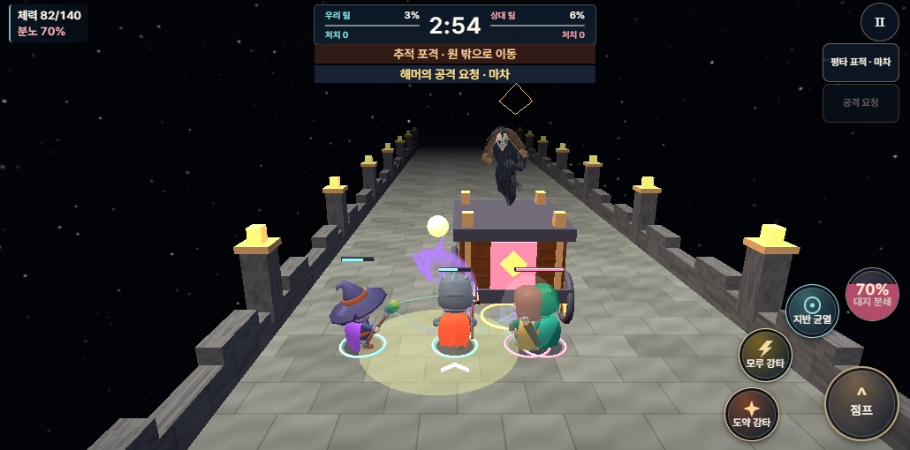
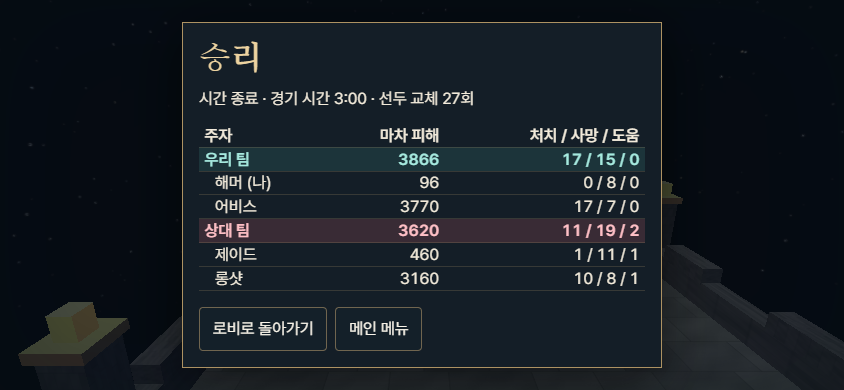

# 런앤레이드 원작 경기와 웹판 플레이테스트

릴딘·카이켄·스위프트·해머의 시점별 영상에서 확인한 조준, 회피와 연계는 [캐릭터별 교전 분석](RUN-AND-RAID-BLADE-PLAY.md)에 정리했다.

## 부활 대기 시간

스위프트의 한 경기에서 전사 화면이 뜨고 조작이 돌아오기까지 첫 번째는 약 1:06~1:16, 두 번째는 3:02~3:17, 세 번째는 4:40~5:00이었다. 릴딘도 약 1:53~2:03과 3:37~3:52로 두 번째 대기가 길었다. 스위프트 영상 5:14에는 상대 한 명의 타이머에 34초가 남아 있다. [스위프트 첫 전사](https://www.youtube.com/watch?v=jSlFzUSup7s&t=65s) · [두 번째](https://www.youtube.com/watch?v=jSlFzUSup7s&t=181s) · [세 번째](https://www.youtube.com/watch?v=jSlFzUSup7s&t=279s) · [후반 상대 타이머](https://www.youtube.com/watch?v=jSlFzUSup7s&t=314s) · [릴딘 두 번째 전사](https://www.youtube.com/watch?v=RggZbGW3Aao&t=216s)

웹판은 주자마다 10초에서 시작해 전사할 때마다 5초씩 늘린다. 최대 35초는 3분 경기용으로 정한 상한이다. 원작의 최댓값과 사망 횟수 외의 보정 조건은 이 영상만으로 확인하기 어렵다.

같은 입력으로 롱샷이 회피 없이 1.5초마다 마차를 공격한 경기에서 팀별 마차 피해는 3,550 대 7,600이었다. 두 주자의 생존 시간을 합한 비율은 각각 48%, 84%였다. 이 차이까지 실제 점수에 반영한다. 영웅별 공격력 회귀 검사는 더 오래 생존한 팀을 기준으로 각 팀이 실제로 공격할 수 있었던 시간에 비례해 기존 75% 피해 기준을 적용한다.

## 출시 당시 플레이 자료

2014년 출시 시기의 서로 다른 플레이어 캡처와 2015년에 게시된 6분 15초짜리 대전 영상을 비교했다. 아래 시각은 영상 재생 위치다. 경기 시계와 구별하기 위해 따로 적었다. 비교 대상은 망각의 서재의 공개 Babylon.js 모드다. [대전 전체 영상](https://www.youtube.com/watch?v=JWcj5IDepiU) · [4월 플레이어 리뷰](https://m.hungryapp.co.kr/bbs/bbs_view.php?bcode=review&pid=46682) · [5월 플레이 기록](https://ittong.kr/2638)

| 장면 | 원본에서 확인한 단서 | 웹판에 적용한 판단 |
| --- | --- | --- |
| 픽과 출발 | 양 팀의 확정 여부가 보이고 네 영웅이 한 화면을 나눠 가진 뒤 경기로 넘어간다. [픽 0:18](https://www.youtube.com/watch?v=JWcj5IDepiU&t=18s) · [출발 전 1:05](https://www.youtube.com/watch?v=JWcj5IDepiU&t=65s) | 파트너·상대·픽 확정을 경기 전에 보여주는 기존 드래프트를 유지한다. |
| 기본 주행 | 경기 시계 4분 54초가 보인다. 좌측에 이동·감속, 우측에 큰 점프와 부채꼴 기술 버튼이 있다. 화면 가운데로 마차와 주자가 보인다. [1:15](https://www.youtube.com/watch?v=JWcj5IDepiU&t=75s) · [출발 캡처](https://appdata.hungryapp.co.kr/data_file/data_img/201404/19/WPZiCEZ13978826124468993.png) | 왼손으로 조향하면서 오른손으로 기술과 회피를 선택한다. 조준 패드를 열었을 때도 점프로 빠져나올 수 있게 했다. |
| 대상·지면 조준 | 지정 시 붉은 대상 표식과 사각 패드가 나타난다. 지면 기술은 도로에 범위가 보인다. 당시 플레이어는 이전에 지정한 상대에게 드래그로 다시 기술을 쓸 수 있다고 설명했다. [지정 캡처](https://appdata.hungryapp.co.kr/data_file/data_img/201404/19/WJDUXY913978812329926293.png) · [지면 캡처](https://appdata.hungryapp.co.kr/data_file/data_img/201404/19/W2GHo3f13978812722168593.png) · [플레이어의 조작 설명](https://m.hungryapp.co.kr/bbs/bbs_view.php?bcode=review&pid=46682) | 지정기만 버튼 밖에서 놓아 재시전한다. 유효한 적과 보호할 아군을 별도로 기억한다. 빈 장판과 방향 사격은 조준한 위치·방향을 따른다. |
| 전사와 재합류 | 쓰러지면 화면이 어두워지고 부활까지 남은 초가 보인다. 전장은 화면에 남아 있다. [1:45](https://www.youtube.com/watch?v=JWcj5IDepiU&t=105s) · [2014년 전사 캡처](https://appdata.hungryapp.co.kr/data_file/data_img/201404/19/Wq5HPBL13978826137946393.png) | 기존 부활 카운트다운을 유지하고, 처치된 주자를 기억한 재시전과 공격 요청은 해당 생명이 끝날 때 해제한다. |
| 팀 공격 요청 | 스위프트를 지목하는 팀원 메시지가 두 차례 보인다. 두 번째 장면에는 전장 위 주황색 표식도 보인다. 원본에서 입력 제스처까지 판별하기는 어렵다. [2:35](https://www.youtube.com/watch?v=JWcj5IDepiU&t=155s) · [4:45](https://www.youtube.com/watch?v=JWcj5IDepiU&t=285s) | 웹판은 평타 표적을 고르고 ‘공격 요청’ 또는 G로 지목한다. 아군에게 대상과 발신자를 표시하고 해당 대상 위에 금색 표식을 띄운다. 아군 봇도 자기 시야에 들어온 요청에 반응한다. |
| 수레 공격과 팀 교전 | 마차를 따라붙은 구간과 주자끼리 싸우는 구간이 번갈아 나오며 상단에 팀 처치 수와 보스 피해 정보가 있다. 종료 4초 전에도 두 정보가 함께 보인다. [3:40](https://www.youtube.com/watch?v=JWcj5IDepiU&t=220s) · [5:45](https://www.youtube.com/watch?v=JWcj5IDepiU&t=345s) · [6:05](https://www.youtube.com/watch?v=JWcj5IDepiU&t=365s) | 경기 중 팀 처치 수를 양쪽 마차 피해율 아래에 표시한다. 승패는 계속 두 팀의 마차 피해로 결정한다. |
| 결과 | 승패와 함께 네 주자가 한 표에 나오고 처치·사망·도움을 볼 수 있다. 영상의 플레이타임은 5분이다. [6:12](https://www.youtube.com/watch?v=JWcj5IDepiU&t=372s) · [2014년 패배 화면](https://appdata.hungryapp.co.kr/data_file/data_img/201404/19/WBNzNhD13978826158720593.png) | 웹판은 같은 표에서 각 주자가 실제로 더한 마차 피해도 보여준다. 적을 막은 플레이와 목표물을 공격한 플레이를 함께 읽을 수 있다. |

## 경기 길이 실험

원작 5월 플레이 기록은 3분 제한을 설명하지만, 다른 원본 캡처에는 4분 이상 남은 경기 시계가 나오고 영상 결과에는 5분이 표시된다. 웹판의 제한 시간은 기존 3분을 유지했다. 실험에서 바꾼 값은 각 팀이 마차를 파괴하기까지 필요한 피해량이다.

일곱 주자를 차례로 첫 좌석에 넣고 웹판의 기존 연습 로스터로 네 자리를 모두 봇에게 맡겼다. 시작 틱, 30Hz 규칙, 봇의 조준·이동과 판정 코드는 동일하다. 표의 범위는 각 조건에서 일곱 경기 중 가장 짧은 경기와 가장 긴 경기의 종료 시간이다.

| 팀별 마차 내구도 | 경기 길이(초, 반올림) |
| --- | --- |
| 2,600 | 40~68 |
| 4,400 | 78~104 |
| 5,200 | 86~123 |
| 6,000 | 109~140 |
| 6,800 | 128~169 |
| 7,600 | 144~180 |

**7,600을 채택했다.** 같은 봇 경기에서 여섯 조합은 제한 시간 전에 마차를 파괴했고 한 조합은 시간 판정까지 갔다. 사람의 조작을 단순화해 한 주자가 1.5초마다 목표물 기술을 시도하는 별도 시나리오에서도 일곱 조합 모두 뒤지는 팀의 피해가 마차 내구도의 75%를 넘었다. 사람끼리의 승률과 만족도는 별도 플레이테스트가 필요하다. [경기·기술 테스트](../babylon/tests/unit/run-and-raid.test.mjs) · [팀 요청 재생 테스트](../babylon/tests/unit/raid-round.test.mjs)

## 처치와 화물 공격 비교

바스티온과 봇 셋으로 시작해 283틱(약 9.4초)에 두 번째 기술을 한 번 썼다. 표적은 마차 또는 체력이 23 남은 롱샷이었다. 이후 추가 조작 없이 8초 동안 두 팀이 새로 준 화물 피해를 비교했다.

| 부활 대기 | 마차를 직접 공격했을 때 (아군 / 적군) | 롱샷을 처치했을 때 (아군 / 적군) |
| --- | --- | --- |
| 5초 | 258 / 128 | 228 / 176 |
| 8초 | 258 / 88 | 288 / 80 |

이 교전에서 5초 대기일 때는 마차를 치는 쪽이 피해 격차를 더 벌렸다. 8초 대기일 때는 롱샷을 처치한 쪽이 38만큼 더 벌렸다. 8초를 적용한 뒤에도 일곱 조합 모두 기존 화물 피해 기준을 통과했고, 해머와 봇 셋의 조기 파괴 시나리오는 161.5초에 끝났다.

위 비교는 보스 추가 피해를 도입하기 전에 측정했다. 원작의 전사 화면에는 부활까지 3초가 남은 시점에 상대 팀 점수 옆에 `BOSS DMG 15%`가 보인다. 웹판은 부활 대기 중인 적 한 명당 15%를 합산해 두 명이면 30%를 적용한다. 원작에서 두 명 전사 시의 수치는 이 화면만으로 확인할 수 없다. [2014년 원작 전사 화면](https://appdata.hungryapp.co.kr/data_file/data_img/201404/19/Wq5HPBL13978826137946393.png)

### 같은 조합에서 선두가 바뀐 횟수

네 자리 모두 봇으로 두고 내구도만 바꿨다. 매 틱이 끝날 때 두 팀의 누적 마차 피해를 비교하고, 직전에 앞서던 팀을 상대가 실제로 추월하면 한 번으로 셌다. 첫 득점과 동점 진입은 제외했다. 동점을 거쳐 상대가 앞서면 한 번이다. 아래 시간은 실제 종료 틱을 30으로 나눈 초다.

| A팀 | B팀 | 2,600 종료(초) | 7,600 종료(초) | 선두 교체(전 → 후) | 승리 팀(전 → 후) |
| --- | --- | ---: | ---: | ---: | --- |
| 해머·어비스 | 롱샷·제이드 | 67.63 | 180.00 | 20 → 23 | B → A |
| 어비스·해머 | 롱샷·제이드 | 49.50 | 172.83 | 7 → 7 | A → A |
| 롱샷·해머 | 어비스·제이드 | 48.50 | 154.03 | 10 → 10 | A → A |
| 제이드·해머 | 어비스·롱샷 | 52.30 | 151.50 | 9 → 9 | A → A |
| 렌드·해머 | 어비스·롱샷 | 40.37 | 143.97 | 7 → 7 | A → A |
| 바스티온·해머 | 어비스·롱샷 | 46.30 | 146.17 | 9 → 9 | A → A |
| 라임·해머 | 어비스·롱샷 | 52.30 | 148.30 | 6 → 6 | A → A |

중앙값은 경기 길이 49.50초에서 151.50초, 선두 교체 9회에서 9회였다. 해머·어비스 조합만 더 길어진 구간에서 세 차례 추가로 역전했고, 마지막에 A팀이 7,516 대 6,978로 이겼다. 나머지 여섯 경기는 앞선 팀이 우위를 지켰다. 내구도를 높인 효과는 재교전에 쓸 시간에서 뚜렷했고, 역전 빈도가 모든 조합에서 늘지는 않았다. 시뮬레이션은 결정적이며 각 행은 좌석 배치 하나를 두 내구도로 실행한 결과다. 추가로 7,600에서 A팀과 B팀의 조합을 맞바꿔 보니 일곱 경기 모두 같은 주자 조합이 반대 진영에서도 이겼다. 이 표본만으로 전체 캐릭터의 밸런스를 단정하기는 어렵다.

### 브라우저 조작 기록

로컬 웹판에서 실제 Photon 아시아 리전의 비공개 방에 세 클라이언트로 접속했다. 한 플레이어가 마차에 공격 요청을 보냈을 때 같은 팀의 두 화면에 같은 발신자와 표적이 나타났고 상대 팀 화면에는 나타나지 않았다. 이 기록은 통신과 조작 검증이다. 별도의 두 클라이언트는 빠른 대전으로 같은 공개 방에 들어갔다. 해머와 제이드를 확정하고 빈자리를 봇으로 채워 3분을 완주했다. 두 화면은 마차 피해 3,902 대 3,620을 각자 팀 시점에서 반대로 표시했다. 개인별 피해의 합도 양쪽 모두 팀 합계와 같았다. 이 경기의 선두 교체 횟수는 계측하지 않았다. 네 사람이 양쪽 내구도 조건에서 치른 경기 기록은 아직 없다.

844×390 가로 브라우저에서 장판 조준 패드를 열고 점프를 누르자 패드가 닫히고 주자가 1.5m 높이까지 뛰었다. 마차 위의 보스는 반격 예고와 발동 시간에 맞춰 자세를 바꾼다. 주자가 같은 위치에 겹칠 때에는 자기 발밑의 흰 화살표로 구분한다.

### 온라인 경기에서 선두 교체 검증

결과 화면은 경기 시간과 선두 교체 횟수를 보여준다. 피해량이 같은 틱에는 마지막으로 앞섰던 팀을 기억한다. 한 틱에서 양쪽 공격을 모두 적용한 뒤 상대 팀이 실제로 앞서야 교체로 센다. 이 규칙으로 위의 7,600 내구도 봇 일곱 조합을 다시 돌렸을 때 이전에 별도로 집계한 횟수와 모두 일치했다.

Photon 비공개 방에서 한국어 호스트가 해머, 영어 게스트가 제이드를 골랐다. 같은 경기를 재현할 수 있도록 두 주자는 시작 이후 전투 입력을 보내지 않았고 각 팀의 남은 한 자리는 봇이 맡았다. 게스트는 도중에 개인 메뉴를 열었다.

| 확인한 화면 | 경기 시간 | 선두 교체 | 우리 팀 마차 피해 | 상대 팀 마차 피해 | 결과 |
| --- | ---: | ---: | ---: | ---: | --- |
| 한국어 호스트 | 3:00 | 27회 | 3,866 | 3,620 | 승리 |
| 영어 게스트 | 3:00 | 27회 | 3,620 | 3,866 | 패배 |

같은 로스터와 입력을 로컬에서 실행해 5,400틱의 마차 피해를 별도로 비교했을 때도 27회였다. 두 브라우저에서 개인 기록의 합이 팀 합계와 일치했고 ‘로비로 돌아가기’를 눌러 다음 경기 입장 화면으로 복귀했다.

